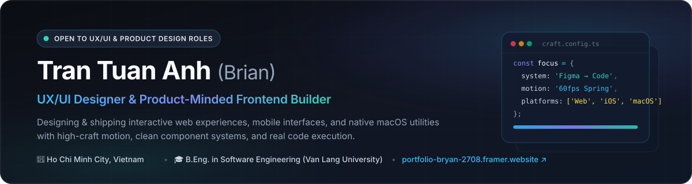

  

   

  

    
    
    
  

---

### 👋 About Me

I'm **Tran Tuan Anh (Brian)**, a **UX/UI Designer** and **Software Engineering graduate** from **Van Lang University**, based in **Ho Chi Minh City, Vietnam**.

- 🎨 **UX/UI Design at Neo Prototype Consulting:** Contributed to **8+ products**, **150+ screens**, and **12+ competitive analyses** — spanning user research, information architecture, user flows, wireframes, responsive component systems, and developer handoff.
- 💻 **Frontend Engineering Foundation:** Former **Front-End Intern at 3P Technology Solutions**, building production **Angular** interfaces for **Hachi Hachi** in close collaboration with Backend Engineers and Product Management.
- ⚡ **Design × Code Execution:** I bridge Figma systems and production interfaces — building interactive prototypes, **60fps motion choreography** (`GSAP`, `Framer Motion`, `React Native Reanimated`), and native apps (`Swift`/`AppKit`, `React Native`).

---

### 🚀 Featured Products & Interactive Case Studies

| Project | Overview & Highlights | Live Experience & Repo |
| :--- | :--- | :--- |
| **🫧 Bubbo for macOS** Native macOS App & Landing Page | Floating macOS chat utility (`Swift` / `AppKit` + isolated `WKWebView` sessions) unifying **7 messaging networks** (Messenger Dual Accounts, Instagram, WhatsApp, Telegram, Discord, Slack, Zalo) with `360° Orbit`, `Vertical Rail`, `Cmd+K Quick Switcher`, `6 Mascot Styles`, and signed Sparkle auto-updates. | 🌐 [**bubbo-macos.pages.dev ↗**](https://bubbo-macos.pages.dev/) 📦 [**Releases Repo**](https://github.com/anhtrantuan2708-beep/bubble-chat-releases) 📖 [**Case Study ↗**](https://portfolio-bryan-2708.framer.website) |
| **🛋️ Shopee AI Room Inspiration** Mobile UX/UI & Interactive Prototype | End-to-end shopping concept turning room inspiration into action: camera room capture, interactive **2D mood-map lens**, **before/after comparison slider**, budget guardrails, and shoppable product hotspots. | 🎮 [**Interactive Demo ↗**](https://anhtrantuan2708-beep.github.io/shopee-ai-room-demo/) ✨ [**Framer Showcase ↗**](https://portfolio-bryan-2708.framer.website/shopee-ui) 💻 [**Source Repo**](https://github.com/anhtrantuan2708-beep/shopee-ai-room-demo) |
| **💌 Grad Letter** 3D Interactive Keepsake Platform | Interactive 3D graduation invitation, Polaroid scrapbook album, and moderated guest keepsake platform with live studio customization (`Three.js` / `WebGL`, `GSAP`, `Cloudflare Pages`, `Supabase`). | 🌐 [**Live Preview ↗**](https://grad-letter-preview.pages.dev/) 📖 [**Case Study ↗**](https://portfolio-bryan-2708.framer.website) |
| **🍸 Sevensens Cocktail Lounge** Editorial Web & Sensory Menu UX | Editorial web concept and interactive cocktail discovery menu featuring flavor-axis filtering, sensory tasting notes, and smooth 60fps scroll choreography. | 🌐 [**Live Preview ↗**](https://sevensens-preview.pages.dev/) 📖 [**Case Study ↗**](https://portfolio-bryan-2708.framer.website) |
| **🚢 Northline Logistics** Responsive Web & Motion System | High-contrast logistics landing page built with structured Swiss typography, interactive freight corridor metrics, and `GSAP ScrollTrigger` motion. | 🌐 [**Live Site ↗**](https://anhtrantuan2708-beep.github.io/northline/) 💻 [**Source Repo**](https://github.com/anhtrantuan2708-beep/northline) |
| **📍 CnS App (Community & Safety)** React Native Mobile Frontend | Real-time community event & safety map app on iOS/Android (`React Native`, `TypeScript`, `Reanimated v3`, `TanStack Query`, `Zustand`) — refining sheet physics, map/list crossfades, and micro-interactions. | 📱 *Active Team Project (iOS/Android)* |
| **⚖️ UIT Data Science Challenge 2026** Vietnamese Legal Information Retrieval | Two-stage legal retrieval pipeline combining **BM25 + Dense Bi-Encoder Retrieval** and **Cross-Encoder Reranking** for Vietnamese legal statutes. | 💻 [**Source Repo**](https://github.com/anhtrantuan2708-beep/uit-dsc-2026-legalir) |

---

### 🛠️ Design & Engineering Toolkit

**Design, Prototyping & Motion**

  
  
  
  
  

**Frontend, Mobile & Native Development**

  
  
  
  
  
  

---

  Designed & built by <b>Tran Tuan Anh (Brian)</b> · Explore full case studies at <a href="https://portfolio-bryan-2708.framer.website"><b>portfolio-bryan-2708.framer.website</b></a>

